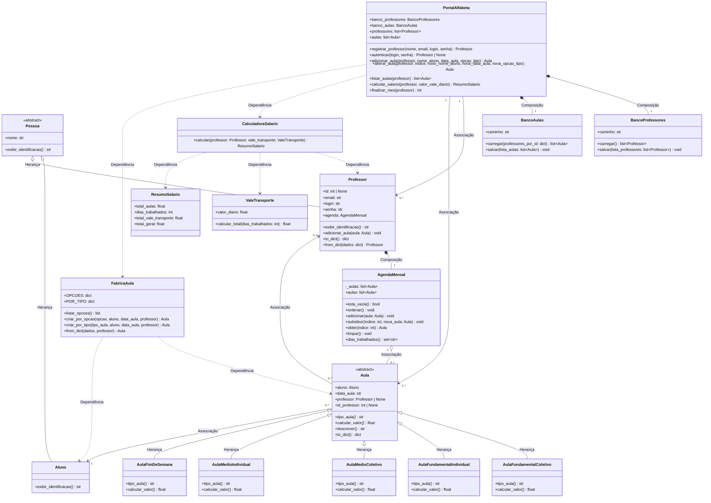

# Diagrama UML — Sistema Alfabeta Reforço Escolar

Este diagrama representa a modelagem completa Orientada a Objetos do sistema, contemplando **Herança**, **Polimorfismo**, **Composição**, **Associação** e **Dependência**.

Visualização vetorial disponível também em [diagrama_uml.svg](./diagrama_uml.svg).
